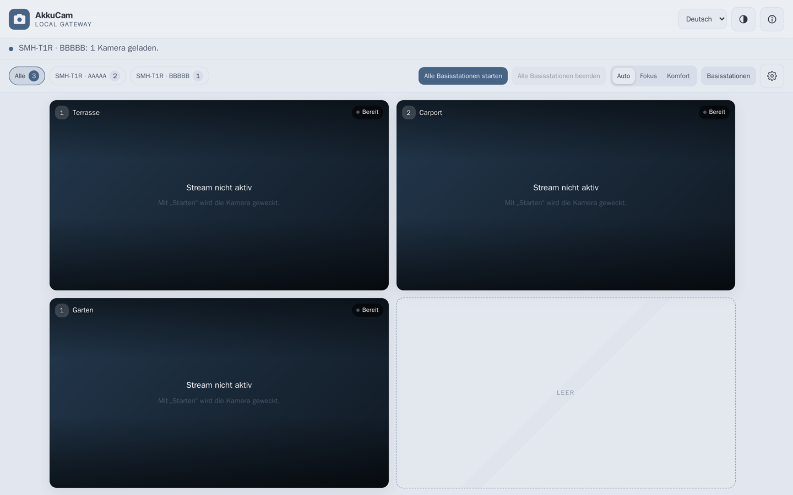
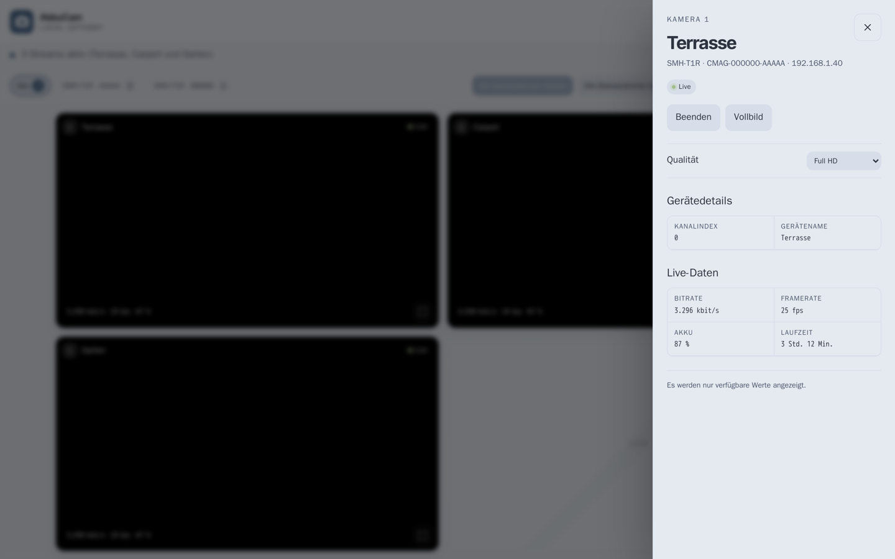
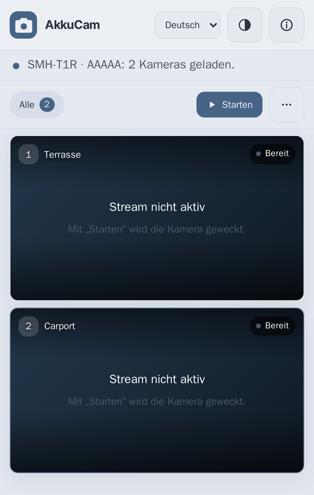

# AkkuCam Gateway

**English** | [Deutsch](README_de.md)

[](LICENSE)
[](https://go.dev/)
[](compose.yaml)
[](specs/architecture.md)
[](specs/roadmap.md)

Live video from the AkkuCam base station in the browser, without the vendor app and without a cloud. The gateway is a single Go process in a container: it finds the base station by broadcast on the local network, opens the PPCS session directly to it, and passes the H.264 stream to the dashboard as HLS via FFmpeg.



*The screenshots show the UI with test data.*

## Features

- LAN discovery via WAI (UDP/7200) and PPCS (UDP/32108), with no directory, relay or firmware endpoint
- session setup and AES challenge authentication directly against the base station, camera list via IO-Control `40962`
- all loaded base stations at once on one live wall, with hub filter, hub manager and global start/stop
- Full HD, HD, SD or automatic quality; the H.264 stream goes to HLS with `-c:v copy`, no re-encoding
- bitrate, FPS and battery level per running stream in an overlay; details drawer with quality, motion detection, uptime and the device metadata that was actually read
- motion detection switchable per camera, as read-modify-write with a read-back check
- three wall views (auto matrix, focus, comfort), light and dark, German and English, layout for desktop, tablet and iPhone
- security code per base station in browser RAM only, never in LocalStorage, logs or files
- HTTP API with an OpenAPI contract and a locally served Swagger UI
- SBOM in CycloneDX and SPDX generated from the runtime image

Tested hardware: base station `SMH-T1R` with firmware `1.0.0.12` and the cameras `PPIC90000`, `PPIC90010` and `PPIC90200`. Other models and firmware versions are untested.

## Requirements

- Linux host with Docker and Docker Compose
- base station on the same IPv4 subnet as the gateway
- free ports: TCP 8080 (dashboard, API, HLS) plus UDP 7200 (WAI) and UDP 32108 (PPCS)
- a browser with Media Source Extensions; Chromium and Firefox are tested

## Getting started

```bash
make up
```

Then open <http://localhost:8080>, click "Discover base stations", enter the security code of the base station and start the streams. The first frame takes a few seconds because starting a stream wakes the camera.

`network_mode: host` is required because discovery uses IPv4 broadcast and Docker bridge networks do not forward those packets. The container runs as an unprivileged user without `privileged` and without `NET_RAW`, and ships a health check against `/api/health`. It keeps no state: HLS segments live in `/tmp/akkucam-hls`, everything else in RAM.

| Variable | Default | Purpose |
| --- | --- | --- |
| `AKKUCAM_LISTEN` | `:8080` | address and port for HTTP |
| `AKKUCAM_WEB_ROOT` | `/app/web` | directory of the static files, set to `$PWD/web` for local development |

### Container image

Releases are published as multi-arch images on the GitHub Container Registry:

```bash
docker pull ghcr.io/akaer/akkucam-gateway:0.1.0-beta.2
docker run -d --name akkucam-gateway --network host ghcr.io/akaer/akkucam-gateway:0.1.0-beta.2
```

The image contains the same binary and web assets as the local build. `network_mode: host` is required for discovery and PPCS.

## Multiple base stations

Each loaded hub keeps its own security code in the browser, keyed by DID and only while the tab stays open. "Base stations" opens the hub manager to add hubs, start and stop them and remove individual codes. The gateway rejects inventory and motion changes with `409 Conflict` while at least one stream is running.

| Details drawer | iPhone |
| --- | --- |
|  |  |

## Security and limits

The gateway is built for a trusted home network. The HTTP API has no authentication of its own and listens on all interfaces; anyone who can reach port 8080 can trigger discovery and session attempts. For VLAN boundaries or remote access, put a reverse proxy with TLS and authentication in front.

The security code lives in browser RAM per DID and in the Go process only while a session is being set up. It does not end up in logs, files or LocalStorage. Go cannot guarantee that strings are overwritten, so "RAM only" is not a cryptographic erase guarantee.

The gateway itself contacts no Oguard or vendor endpoints. The base station can still open its own internet connections; only firewall rules on the router stop that.

Not included: recording and playback of video, audio and two-way talk, user management, remote access.

## API

```text
GET  /api/health
POST /api/discover
POST /api/session/probe
POST /api/session/authenticate
POST /api/channels
POST /api/motion
POST /api/live/start
POST /api/live/stop
GET  /api/live/status?id=<stream-id>
GET  /api/openapi.json
GET  /api/docs
```

`/api/openapi.json` serves the contract, `/api/docs` a locally bundled Swagger UI. Neither uses a CDN. `/api/live/start` returns a stream ID of the form `<DID>-ch<N>`; at most one stream runs per DID and channel.

```bash
curl -s -X POST http://localhost:8080/api/discover
```

Error responses carry a stable `code` next to `error`:

```json
{"error":"valid ip, did and securityCode are required","code":"validation_failed"}
```

The full reference is in [specs/api.md](specs/api.md).

## Protocol

The gateway reimplements the observed part of the local protocol, without vendor code:

- WAI discovery: broadcast to `255.255.255.255:7200`, request `WAI0`, reply `WAI1` with DID and model
- PPCS discovery: broadcast to `255.255.255.255:32108`, request `f1 30 00 00`, reply `f1 41 ...`; the UDP source port of the reply is the dynamic PPCS port of the hub
- media fragments: `f1 d0 <length BE> d1 01 <sequence BE> <H.264>`, Annex-B with SPS/PPS/IDR
- verified stream: H.264 Main Profile, 1920×1080, 25 fps

Details and open fields: [specs/protocol.md](specs/protocol.md).

## Tests

```bash
make test        # go vet, unit, API and integration tests, race detector, image build
make lint        # static analysis in pinned images (Go, JS, shell, Dockerfile)
make test-e2e    # Playwright in Chromium and Firefox
```

`make test` and `make lint` need only Docker, no local Go. The browser run expects a running gateway (`make up`) and uses Playwright in a pinned image. Test setup, hardware runs and coverage are described in [specs/testing.md](specs/testing.md). CI runs the static analysis, the Go tests, the image build, SBOM generation and Playwright.

## Development

Without an image rebuild, the gateway serves the dashboard straight from the working directory:

```bash
AKKUCAM_WEB_ROOT=$PWD/web go run ./cmd/gateway
```

Changes under `web/` need a new container build.

The version lives in `internal/version/version.go`. `make up`, `make test` and CI pass the Git commit to the build; the help dialog and `GET /api/version` show both. Releases use semantic versioning and are tagged `v<version>` on `main`; published releases are on [GitHub](https://github.com/akaer/akkucam-gateway/releases) and as images in the GitHub Container Registry. See [`CONTRIBUTING.md`](CONTRIBUTING.md) for branches, pull requests and the release steps.

## SBOM

[`sbom/`](sbom/README.md) holds the software bill of materials of the runtime image in CycloneDX and SPDX. Regenerate it after changing the image:

```bash
./scripts/sbom.sh    # or: make sbom
```

The script exports the image with `docker save` and scans the archive in a pinned Syft container, without a Docker socket.

## License and third-party components

The gateway is released under the MIT license, see [`LICENSE`](LICENSE). The license dialog in the dashboard (info icon → licenses) lists the same components.

| Component | License | License text |
| --- | --- | --- |
| hls.js | Apache 2.0 | [`web/HLS-LICENSE.txt`](web/HLS-LICENSE.txt) |
| Font Awesome Free 6.7.2 (camera icon) | Icons: CC BY 4.0 | [`web/FONTAWESOME-LICENSE.txt`](web/FONTAWESOME-LICENSE.txt) |
| Inter Tight (brand name and large headings) | SIL OFL 1.1 | [`web/INTERTIGHT-LICENSE.txt`](web/INTERTIGHT-LICENSE.txt) |
| Swagger UI | Apache 2.0 | [`web/swagger/LICENSE`](web/swagger/LICENSE) |
| FFmpeg (in the runtime image) | GPL-2.0-or-later | see SBOM |
| Alpine Linux (in the runtime image) | various | see SBOM |
| Go (in the runtime image) | BSD-3-Clause | see SBOM |

## Origin and trademarks

The protocol was reconstructed from observed network traffic and experiments on own hardware; no vendor code is included (ADR-0005). The base station stays unmodified and does not need to be flashed.

ABUS and AkkuCam are trademarks of their respective owners. This project is independent and neither supported by nor affiliated with the manufacturer.

Bug reports are welcome in the [issue tracker](https://github.com/akaer/akkucam-gateway/issues); keep real security codes, DIDs and local IPs out of them. Security issues go through the process in [`SECURITY.md`](SECURITY.md).

## Documentation

Architecture, protocol, API, security, test strategy, roadmap and ADRs: [`specs/README.md`](specs/README.md). The documents are written in English.
