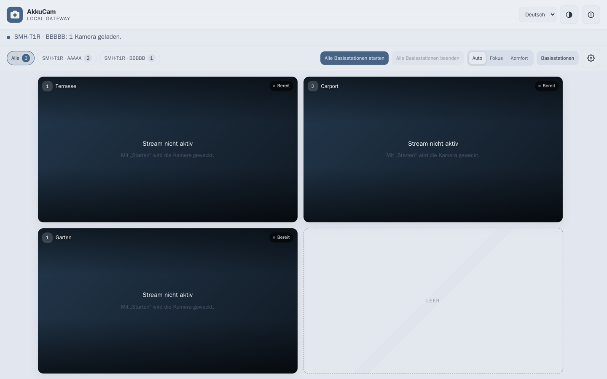
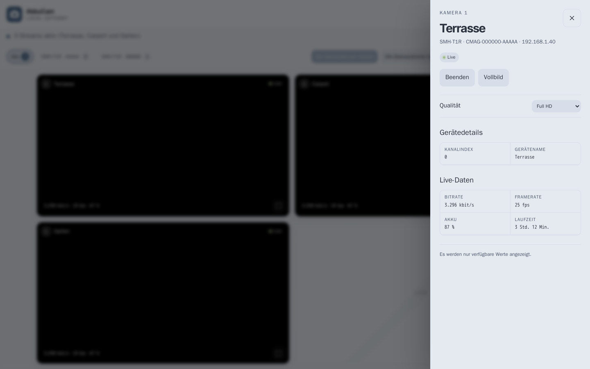
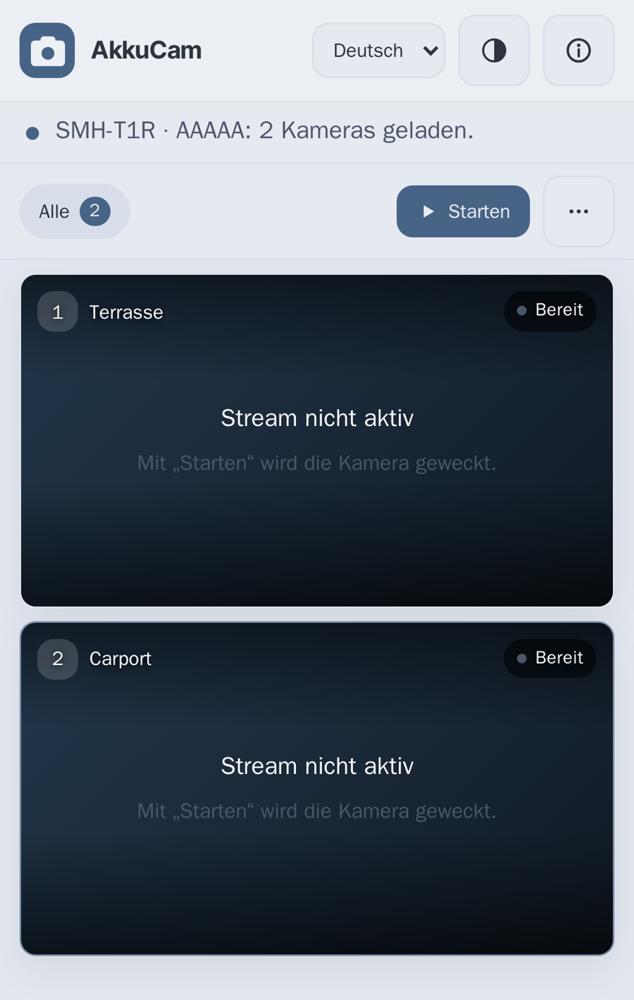

# AkkuCam Gateway

[English](README.md) | **Deutsch**

[](https://github.com/akaer/akkucam-gateway/actions/workflows/test.yml)
[](https://github.com/akaer/akkucam-gateway/security/code-scanning)
[](https://github.com/akaer/akkucam-gateway/releases)
[](LICENSE)
[](https://go.dev/)
[](https://github.com/akaer/akkucam-gateway/pkgs/container/akkucam-gateway)
[](specs/architecture.md)

Livebilder der AkkuCam-Basisstation im Browser, ohne Hersteller-App und ohne Cloud. Der Gateway ist ein einzelner Go-Prozess im Container: er findet die Basisstation per Broadcast im lokalen Netz, baut die PPCS-Sitzung direkt zu ihr auf und reicht das H.264-Bild über FFmpeg als HLS an das Dashboard weiter.



*Die Screenshots zeigen die Oberfläche mit Testdaten.*

## Funktionen

- LAN-Discovery über WAI (UDP/7200) und PPCS (UDP/32108), ohne Verzeichnis-, Relay- oder Firmware-Endpunkt
- Sitzungsaufbau und AES-Challenge-Authentifizierung direkt gegen die Basisstation, Kameraliste über IO-Control `40962`
- alle geladenen Basisstationen gleichzeitig in einer Live-Wand, mit Hub-Filter, Hub-Manager und globalem Start/Stop
- Qualität Full HD, HD, SD oder automatisch; das H.264-Bild geht mit `-c:v copy` nach HLS, ohne Neukodierung
- Bitrate, FPS und Akkustand pro laufendem Stream als Overlay; Details-Drawer mit Qualität, Bewegungserkennung, Laufzeit und vorhandenen Gerätemetadaten
- Bewegungserkennung pro Kamera schaltbar, als Read-Modify-Write mit Rückprüfung
- drei Wand-Ansichten (Auto-Matrix, Fokus, Komfort), Light und Dark, Deutsch und Englisch, Layout für Desktop, Tablet und iPhone
- Sicherheitscode je Basisstation nur im Browser-RAM, nie in LocalStorage, Logs oder Dateien
- HTTP-API mit OpenAPI-Vertrag und lokal ausgelieferter Swagger UI
- SBOM in CycloneDX und SPDX aus dem Laufzeitimage
- Multi-Arch-Containerimage für linux/amd64 und linux/arm64, verifiziert auf einem Raspberry Pi 4 Model B Rev 1.4

Verifiziert ist die Basisstation `SMH-T1R` mit Firmware `1.0.0.12` und den Kameras `PPIC90000`, `PPIC90010` und `PPIC90200`. Andere Modelle und Firmwarestände sind nicht getestet. Getestete Hosts: Linux/NixOS x86-64 und ein Raspberry Pi 4 Model B Rev 1.4 mit 64-Bit-Betriebssystem.

## Voraussetzungen

- 64-Bit-Linux-Host mit Docker und Docker Compose (x86-64 oder arm64); verifiziert auf einem Raspberry Pi 4 Model B Rev 1.4
- Basisstation im selben IPv4-Subnetz wie der Gateway
- freie Ports: TCP 8080 (Dashboard, API, HLS) sowie UDP 7200 (WAI) und UDP 32108 (PPCS)
- Browser mit Media Source Extensions; getestet sind Chromium und Firefox

## Start

```bash
make up
```

Danach <http://localhost:8080> öffnen, „Basisstationen suchen“ klicken, den Sicherheitscode der Basisstation eingeben und die Streams starten. Der erste Frame braucht einige Sekunden, weil der Start die Kamera aufweckt.

`network_mode: host` ist erforderlich, weil Discovery über IPv4-Broadcast läuft und Docker-Bridge-Netze diese Pakete nicht weiterreichen. Der Container läuft als unprivilegierter Benutzer ohne `privileged` und ohne `NET_RAW` und bringt einen Healthcheck gegen `/api/health` mit. Er hält keinen Zustand: HLS-Segmente liegen unter `/tmp/akkucam-hls`, alles andere im RAM. Die HTTP-API hat keine eigene Authentifizierung; Port 8080 gehört ins lokale Netz und nicht ins Internet.

| Variable | Standard | Zweck |
| --- | --- | --- |
| `AKKUCAM_LISTEN` | `:8080` | Adresse und Port für HTTP |
| `AKKUCAM_WEB_ROOT` | `/app/web` | Verzeichnis der statischen Dateien, für lokale Entwicklung auf `$PWD/web` setzen |

### Container-Image

Releases erscheinen als Multi-Arch-Image in der GitHub Container Registry:

```bash
docker pull ghcr.io/akaer/akkucam-gateway:0.2.1
docker run -d --name akkucam-gateway --network host ghcr.io/akaer/akkucam-gateway:0.2.1
```

Das Image enthält dasselbe Binary und dieselben Web-Assets wie der lokale Build. Die arm64-Variante läuft auf einem Raspberry Pi 4 Model B Rev 1.4 mit 64-Bit-Betriebssystem. `network_mode: host` ist für Discovery und PPCS erforderlich.

## Mehrere Basisstationen

Jeder geladene Hub hält seinen eigenen Sicherheitscode im Browser, getrennt nach DID und nur solange der Tab offen ist. „Basisstationen“ öffnet den Hub-Manager zum Hinzufügen, Starten, Stoppen und zum Entfernen einzelner Codes. Inventar- und Bewegungsänderungen lehnt der Gateway mit `409 Conflict` ab, solange mindestens ein Stream läuft.

| Details-Drawer | iPhone |
| --- | --- |
|  |  |

## Sicherheit und Grenzen

Der Gateway ist für ein vertrauenswürdiges Heimnetz gedacht. Die HTTP-API hat keine eigene Authentifizierung und lauscht auf allen Interfaces; wer Port 8080 erreicht, kann Discovery und Sitzungsversuche auslösen. Für VLAN-Grenzen oder Fernzugriff gehört ein Reverse Proxy mit TLS und Authentifizierung davor.

Der Sicherheitscode liegt je DID im Browser-RAM und im Go-Prozess nur während des Sitzungsaufbaus. Er landet nicht in Logs, Dateien oder im LocalStorage. Go kann Strings nicht garantiert überschreiben, „nur im RAM“ ist deshalb keine kryptografische Löschgarantie.

Der Gateway selbst kontaktiert keine Oguard- oder Hersteller-Endpunkte. Die Basisstation kann unabhängig davon weiterhin eigene Internetverbindungen aufbauen; das lässt sich nur per Firewall am Router abstellen.

Nicht enthalten: Aufzeichnung und Wiedergabe von Videos, Audio und Gegensprechen, Benutzerverwaltung, Fernzugriff.

## API

```text
GET  /api/health
POST /api/discover
POST /api/session/probe
POST /api/session/authenticate
POST /api/channels
POST /api/motion
POST /api/live/start
POST /api/live/stop
GET  /api/live/status?id=<stream-id>
GET  /api/openapi.json
GET  /api/docs
```

`/api/openapi.json` liefert den Vertrag, `/api/docs` eine lokal gebündelte Swagger UI. Beide kommen ohne CDN aus. `/api/live/start` gibt eine Stream-ID der Form `<DID>-ch<N>` zurück; pro DID und Kanal läuft höchstens ein Stream.

```bash
curl -s -X POST http://localhost:8080/api/discover
```

Fehlerantworten enthalten neben `error` einen stabilen `code`:

```json
{"error":"valid ip, did and securityCode are required","code":"validation_failed"}
```

Die vollständige Referenz steht in [specs/api.md](specs/api.md).

## Protokoll

Der Gateway implementiert den beobachteten Teil des lokalen Protokolls neu, ohne Herstellercode:

- WAI-Discovery: Broadcast an `255.255.255.255:7200`, Anfrage `WAI0`, Antwort `WAI1` mit DID und Modell
- PPCS-Discovery: Broadcast an `255.255.255.255:32108`, Anfrage `f1 30 00 00`, Antwort `f1 41 ...`; der UDP-Quellport der Antwort ist der dynamische PPCS-Port des Hubs
- Medienfragmente: `f1 d0 <Länge BE> d1 01 <Sequenz BE> <H.264>`, Annex-B mit SPS/PPS/IDR
- verifizierter Stream: H.264 Main Profile, 1920×1080, 25 fps

Details und offene Felder: [specs/protocol.md](specs/protocol.md).

## Tests

```bash
make test        # go vet, Unit-, API- und Integrationstests, Race Detector, Image-Build
make lint        # statische Analyse in gepinnten Images (Go, JS, Shell, Dockerfile)
make test-e2e    # Playwright in Chromium und Firefox
```

`make test` und `make lint` brauchen nur Docker, kein lokales Go. Der Browserlauf setzt ein laufendes Gateway voraus (`make up`) und nutzt Playwright im gepinnten Image. Testaufbau, Hardwaretests und Abdeckung stehen in [specs/testing.md](specs/testing.md). Die CI führt statische Analyse, Go-Tests, Image-Build, SBOM-Erzeugung und Playwright aus.

## Entwicklung

Ohne Image-Rebuild liefert der Gateway das Dashboard direkt aus dem Arbeitsverzeichnis:

```bash
AKKUCAM_WEB_ROOT=$PWD/web go run ./cmd/gateway
```

Nach Änderungen an `web/` ist für den Container ein neuer Build nötig.

Die Version steht in `internal/version/version.go`. `make up`, `make test` und die CI übergeben den Git-Commit an den Build; Hilfe-Dialog und `GET /api/version` zeigen beides. Releases folgen semantischer Versionierung und werden auf `main` mit `v<version>` getaggt; veröffentlichte Releases stehen auf [GitHub](https://github.com/akaer/akkucam-gateway/releases) und als Images in der GitHub Container Registry. Branch-, PR- und Release-Ablauf stehen in [`CONTRIBUTING.md`](CONTRIBUTING.md).

## SBOM

[`sbom/`](sbom/README.md) enthält die Software-Stückliste des Laufzeitimages in CycloneDX und SPDX. Neu erzeugen nach Änderungen am Image:

```bash
./scripts/sbom.sh    # oder: make sbom
```

Das Skript exportiert das Image mit `docker save` und scannt das Archiv in einem gepinnten Syft-Container, ohne Docker-Socket.

## Lizenz und Drittanbieter

Der Gateway steht unter der MIT-Lizenz, siehe [`LICENSE`](LICENSE). Dieselbe Aufstellung zeigt der Lizenzdialog im Dashboard (Info-Icon → Lizenzen).

| Komponente | Lizenz | Lizenztext |
| --- | --- | --- |
| hls.js | Apache 2.0 | [`web/HLS-LICENSE.txt`](web/HLS-LICENSE.txt) |
| Font Awesome Free 6.7.2 (Kamera-Icon) | Icons: CC BY 4.0 | [`web/FONTAWESOME-LICENSE.txt`](web/FONTAWESOME-LICENSE.txt) |
| Inter Tight (Markenname und große Überschriften) | SIL OFL 1.1 | [`web/INTERTIGHT-LICENSE.txt`](web/INTERTIGHT-LICENSE.txt) |
| Swagger UI | Apache 2.0 | [`web/swagger/LICENSE`](web/swagger/LICENSE) |
| FFmpeg (im Laufzeitimage) | GPL-2.0-or-later | unverändertes Alpine-Paket, [Quelle](https://gitlab.alpinelinux.org/alpine/aports/-/tree/master/main/ffmpeg); Lizenzen im SBOM |
| Alpine Linux (im Laufzeitimage) | diverse | siehe SBOM |
| Go (im Laufzeitimage) | BSD-3-Clause | siehe SBOM |

## Herkunft und Marken

Das Protokoll ist aus beobachtetem Netzwerkverkehr und Versuchen an eigener Hardware nachgebaut, Code des Herstellers ist nicht enthalten (ADR-0005). Die Basisstation bleibt unverändert und muss nicht geflasht werden.

ABUS und AkkuCam sind Marken ihrer Inhaber. Dieses Projekt ist unabhängig und weder vom Hersteller unterstützt noch mit ihm verbunden.

Fehlerberichte sind willkommen im [Issue-Tracker](https://github.com/akaer/akkucam-gateway/issues); Sicherheitscode, DID und lokale IP-Adressen gehören nicht hinein. Sicherheitslücken laufen über den Ablauf in [`SECURITY.md`](SECURITY.md).

## Dokumentation

Architektur, Protokoll, API, Sicherheit, Teststrategie, Roadmap und ADRs: [`specs/README.md`](specs/README.md). Die Dokumente sind auf Englisch.
