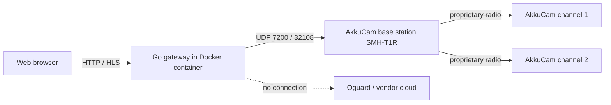

# Architecture

## System context



The base station stays responsible for radio, wake-up and camera coupling. The
gateway replaces the local network and media part of the app.

## Container architecture

```mermaid
flowchart TB
    HTTP[net/http API + static UI]
    Discovery[internal/discovery]
    PPCS[internal/ppcs]
    Manager[internal/stream manager]
    FFmpeg[FFmpeg remuxer]
    HLS[/tmp/akkucam-hls]

    HTTP --> Discovery
    HTTP --> Manager
    Manager --> PPCS
    PPCS -- Annex-B H.264 --> FFmpeg
    FFmpeg --> HLS
    HTTP --> HLS
```

## Components

### `cmd/gateway`

- entry point, configuration through environment variables
- starts the HTTP server and wires the packages
- no routing, validation or protocol logic

### `internal/gateway`

- HTTP routing, input validation and error mapping
- one route table as the source for paths and methods
- contract tests for the API and OpenAPI

### `internal/apierr`

- stable error codes and the flat JSON error format
- central mapping from sentinel errors to HTTP status

### `internal/openapi`

- embedded OpenAPI 3.0 contract
- served at `/api/openapi.json`; the Swagger UI sits under `web/swagger/`

### `internal/discovery`

- WAI0/WAI1 on UDP/7200
- PPPP LAN discovery on UDP/32108
- merge by IP
- prefers the more complete DID so `CMAG` does not overwrite a known complete DID

### `internal/ppcs`

- PPPP header and PUNCH packets
- direct LAN handshake
- AES challenge authentication
- DRW data channels, ACKs and keepalive
- fragment order and app frame reassembly
- IO-Control for StartVideo, StartAudio and battery
- H.264 detection and decapsulation

### `internal/stream`

- exactly one active stream per DID and channel
- different channels of the same base station run in parallel
- a restart replaces only an existing stream of the same channel
- starts and stops FFmpeg
- counts H.264 payload bytes per second
- keeps transient runtime metadata such as channel, battery and uptime

### Web interface

- vanilla HTML, CSS and JavaScript
- locally bundled `hls.js`
- no external runtime resources
- the security code is requested per base station in a browser dialog, held in
  browser RAM under the DID and never stored (ADR-0012, ADR-0025)
- every loaded base station appears in one shared live wall; loading another
  station keeps all existing streams and tiles (ADR-0026, ADR-0027)
- after the first load the wall replaces the setup page; the hub manager opens the
  setup page to add more stations
- setup and wall share a full-width shell with a compact notice bar, toolbar style
  and 16 px gutters; the setup page uses a setup bar, an empty state and the
  full-width hub grid
- auto matrix, focus and comfort compute columns and tile sizes from the camera
  count and the viewport; tiles start at the top and odd counts leave empty grid
  cells
- hub filter chips hide stations without stopping streams; the hub manager controls
  start/stop and codes per station
- global actions "Start all base stations" and "Stop all base stations" start or
  stop every channel of every loaded hub; each station stays individually
  controllable
- inventory and motion actions are locked while any stream runs, matching the API
  that returns `409 conflict` for active streams
- a click on a tile opens the details drawer; running streams show bitrate, FPS and
  battery permanently as an overlay in the bottom left (switchable, ADR-0031)
- the focus strip draws live thumbnails from the existing video elements onto
  canvas; invisible videos stay in the offscreen `#stream-holder` and keep their
  HLS instance
- view, filter and language changes move existing `<video>` elements and HLS
  instances instead of recreating them
- iPhone sizes use a compact wall bar with filter pill, start/stop and menu sheet;
  iPad and desktop keep the full bar (ADR-0027)
- the selected wall view sits in `localStorage['akkucam-wall-view']`; the settings
  dialog can reset it
- `web/i18n.js` and `web/locales/{en,de}.json` provide the bilingual interface
  (ADR-0021)
- English is the source and fallback language; `de*` browsers start in German
- language switching runs without a reload and does not interrupt streams
- `web/e2e/` contains Playwright tests for language, error codes, branding, the
  live wall and optionally real hardware
- the API stays English; the UI translates stable error codes on the client
- brand mark and favicon use the locally bundled Font Awesome camera icon
  (`web/icon-light.svg`, `web/icon-dark.svg`); both variants follow the theme
  (ADR-0022)
- brand name and step headings (`h2`) use the locally bundled Inter Tight
  (regular/bold) under `web/fonts/`; no Google Fonts CDN (ADR-0023)
- `web/style.css` is built on tokens: six type steps, two weights (400/700), three
  radii, four shadows, two blur levels; text contrast at least 4.5:1 in both themes
  (ADR-0029)
- icons come from an inline sprite in `index.html` (24 px grid, `currentColor`);
  text glyphs, icon fonts and CDNs are excluded (ADR-0029)
- UI copy consists of whole sentences from the catalogs; the client formats
  numbers, durations and lists with `Intl`, and the API delivers machine values
  (ADR-0028)
- tiles are `role="group"` with an `aria-label`; icon buttons have a 44 px hit
  area, and mobile sheets respect the safe area (ADR-0030)
- tile frames and shadows are theme-aware; the light theme uses light, soft frames,
  the dark theme subtle light edges
- the hero text block is removed; discover and "Back to the live wall" sit in the
  setup bar
- an info icon at the far right of the top bar (right of the theme toggle) opens a
  modal help popup (`#help-dialog`) with the flow in the active language
  (ADR-0024)
- there is no page footer and no separate `web/licenses.html`; license and API
  information open through the help popup as a scrollable license dialog with the
  MIT project license and all third-party components
- the SBOM (CycloneDX and SPDX) is generated from the runtime image and sits under
  `sbom/` (ADR-0022)

## Media flow

1. The camera delivers H.264 over PPCS DRW channel 1.
2. The gateway orders fragments by the 16-bit sequence number.
3. App frames are assembled from their 24-bit length field.
4. The encrypted frame header is decrypted with the session key.
5. The payload is de-obfuscated with the byte given in the header.
6. Annex-B H.264 is written unchanged to FFmpeg.
7. FFmpeg sets PTS/DTS and remuxes to MPEG-TS/HLS; `-c:v copy` prevents
   re-encoding.
8. The browser plays HLS through the locally bundled `hls.js`.

## Concurrency

- Discovery uses parallel WAI and PPCS probes.
- A process mutex serializes control sessions to prevent competing PUNCH/auth
  flows.
- The active media loop runs in its own goroutine.
- FFmpeg runs as a child process and is stopped through context cancellation.
- Bitrate measurement runs in a separate one-second goroutine.

## Runtime data

HLS files are stored only under `/tmp/akkucam-hls/<DID>/`. They are transient and
disappear on container restart. There is deliberately no video archive.
