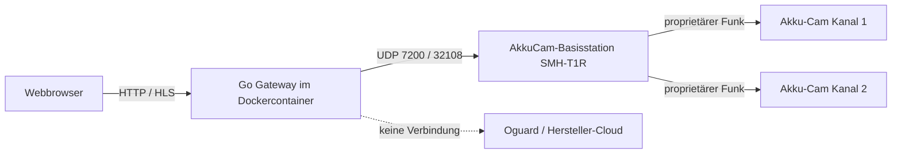

# Architektur

## Systemkontext



Die Basisstation bleibt für Funk, Wake-up und Kamera-Kopplung zuständig. Der Gateway ersetzt den lokalen Netzwerk- und Medienanteil der App.

## Containerarchitektur

```mermaid
flowchart TB
    HTTP[net/http API + statische UI]
    Discovery[internal/discovery]
    PPCS[internal/ppcs]
    Manager[internal/stream Manager]
    FFmpeg[FFmpeg Remuxer]
    HLS[/tmp/akkucam-hls]

    HTTP --> Discovery
    HTTP --> Manager
    Manager --> PPCS
    PPCS -- Annex-B H.264 --> FFmpeg
    FFmpeg --> HLS
    HTTP --> HLS
```

## Komponenten

### `cmd/gateway`

- Einstiegspunkt, Konfiguration über Umgebungsvariablen
- startet den HTTP-Server und verbindet die Pakete
- keine Routing-, Validierungs- oder Protokollogik

### `internal/gateway`

- HTTP-Routing, Eingabevalidierung und Fehler-Mapping
- eine einzige Routentabelle als Quelle für Pfade und Methoden
- Contract-Tests für API und OpenAPI

### `internal/apierr`

- stabile Fehlercodes und das flache JSON-Fehlerformat
- zentrale Abbildung von Sentinel-Fehlern auf HTTP-Status

### `internal/openapi`

- eingebetteter OpenAPI-3.0-Vertrag
- Auslieferung unter `/api/openapi.json`; die Swagger UI liegt unter `web/swagger/`

### `internal/discovery`

- WAI0/WAI1 auf UDP/7200
- PPPP-LAN-Discovery auf UDP/32108
- Zusammenführung nach IP
- bevorzugt die vollständigere DID, damit `CMAG` eine bereits bekannte vollständige DID nicht überschreibt

### `internal/ppcs`

- PPPP-Header und PUNCH-Pakete
- direkter LAN-Handshake
- AES-Challenge-Authentifizierung
- DRW-Datenkanäle, ACKs und Keepalive
- Fragmentreihenfolge und App-Frame-Reassembly
- IO-Control für StartVideo, StartAudio und Batterie
- H.264-Erkennung und Dekapselung

### `internal/stream`

- genau ein aktiver Stream pro DID und Kanal
- unterschiedliche Kanäle derselben Basisstation laufen parallel
- ersetzt beim erneuten Start nur einen bestehenden Stream desselben Kanals
- startet und beendet FFmpeg
- zählt H.264-Nutzdatenbytes pro Sekunde
- hält flüchtige Laufzeitmetadaten wie Kanal, Akku und Uptime

### Weboberfläche

- Vanilla HTML, CSS und JavaScript
- lokal gebündeltes `hls.js`
- keine externen Laufzeitressourcen
- Sicherheitscode wird per Browserdialog je Basisstation abgefragt, im Browser-RAM unter der DID gehalten und nicht gespeichert (ADR-0012, ADR-0025)
- jede geladene Basisstation erscheint in einer gemeinsamen Live-Wand; beim Laden einer weiteren Station bleiben alle bisherigen Streams und Kacheln erhalten (ADR-0026, ADR-0027)
- nach dem ersten Laden ersetzt die Wand die Setup-Seite; der Hub-Manager öffnet die Setup-Seite zum Hinzufügen weiterer Stationen
- Setup und Wand teilen sich eine Vollbreiten-Hülle mit kompaktem Hinweisbalken, Werkzeugleisten-Stil und 16-px-Rändern; die Setup-Seite nutzt eine Setup-Leiste, einen Empty State und das vollbreite Hub-Raster
- Auto-Matrix, Fokus und Komfort berechnen Spalten und Kachelgrößen aus Kameraanzahl und Viewport; Kacheln beginnen oben, ungerade Anzahlen ergeben leere Rasterzellen
- Hub-Filterchips blenden Stationen aus, ohne Streams zu beenden; der Hub-Manager steuert Start/Stop und Codes pro Station
- globale Aktionen „Alle Basisstationen starten“ und „Alle Basisstationen beenden“ starten bzw. beenden alle Kanäle aller geladenen Hubs; jede Station bleibt zusätzlich einzeln steuerbar
- Inventar- und Bewegungsaktionen sind gesperrt, solange irgendein Stream läuft – passend zur API, die bei aktiven Streams `409 conflict` liefert
- Klick auf eine Kachel öffnet den Details-Drawer; laufende Streams zeigen Bitrate, FPS und Akku dauerhaft als Overlay unten links (abschaltbar, ADR-0031)
- der Fokus-Streifen zeichnet Miniatur-Livebilder aus den vorhandenen Videoelementen auf Canvas; nicht sichtbare Videos bleiben im offscreen `#stream-holder` und behalten ihre HLS-Instanz
- Ansichts-, Filter- und Sprachwechsel hängen vorhandene `<video>`-Elemente und HLS-Instanzen um, statt sie neu zu erzeugen
- iPhone-Größen nutzen eine kompakte Wand-Leiste mit Filter-Pill, Start/Stop und Menü-Sheet; iPad/Desktop behalten die volle Leiste (ADR-0027)
- die gewählte Wand-Ansicht liegt in `localStorage['akkucam-wall-view']`; der Einstellungsdialog kann sie zurücksetzen
- `web/i18n.js` und `web/locales/{en,de}.json` liefern die zweisprachige Oberfläche (ADR-0021)
- Englisch ist Quell- und Fallbacksprache; `de*`-Browser starten auf Deutsch
- Sprachwechsel läuft ohne Reload und unterbricht keine Streams
- `web/e2e/` enthält Playwright-Tests für Sprache, Fehlercodes, Branding, Live-Wand und optional echte Hardware
- die API bleibt englisch; die UI übersetzt stabile Fehlercodes clientseitig
- Markenzeichen und Favicon nutzen das lokal gebündelte Font-Awesome-Kamera-Icon (`web/icon-light.svg`, `web/icon-dark.svg`); beide Varianten folgen dem Theme (ADR-0022)
- Markenname und Schritt-Headings (`h2`) nutzen die lokal gebündelte Inter Tight (Regular/Bold) unter `web/fonts/`; kein Google-Fonts-CDN (ADR-0023)
- `web/style.css` ist über Tokens aufgebaut: sechs Schriftstufen, zwei Gewichte (400/700), drei Radien, vier Schatten, zwei Blur-Ebenen; Textkontrast ≥ 4,5:1 in beiden Themes (ADR-0029)
- Icons kommen aus einem Inline-Sprite in `index.html` (24-px-Raster, `currentColor`); Textglyphen, Icon-Fonts und CDN sind ausgeschlossen (ADR-0029)
- UI-Texte sind vollständige Sätze aus den Katalogen; der Client formatiert Zahlen, Laufzeiten und Listen mit `Intl`, die API liefert Maschinenwerte (ADR-0028)
- Kacheln sind `role="group"` mit `aria-label`; Icon-Buttons haben 44 px Trefferfläche, mobile Sheets beachten die Safe Area (ADR-0030)
- Kachelrahmen und Schatten sind themeabhängig; das Light Theme nutzt helle, weiche Rahmen, das Dark Theme dezente helle Kanten
- der Hero-Textblock entfällt; Discover und „Zurück zur Live-Wand“ sitzen in der Setup-Leiste
- ein Info-Icon ganz rechts im Topbar (rechts neben der Theme-Umschaltung) öffnet ein modales Hilfe-Popup (`#help-dialog`) mit dem Ablauf in der aktiven Sprache (ADR-0024)
- es gibt keinen Seiten-Footer und keine separate `web/licenses.html`; Lizenz- und API-Informationen öffnen sich über das Hilfe-Popup als scrollbarer Lizenzdialog mit MIT-Projektlizenz und allen Drittkomponenten
- die SBOM (CycloneDX und SPDX) wird aus dem Laufzeitimage erzeugt und liegt unter `sbom/` (ADR-0022)

## Medienfluss

1. Kamera liefert H.264 über PPCS DRW-Kanal 1.
2. Der Gateway sortiert Fragmente anhand der 16-Bit-Sequenznummer.
3. App-Frames werden anhand ihrer 24-Bit-Längenangabe zusammengesetzt.
4. Der verschlüsselte Frame-Header wird mit dem Session-Key entschlüsselt.
5. Die Nutzdaten werden mit dem im Header angegebenen Byte de-obfuskiert.
6. Annex-B-H.264 wird unverändert an FFmpeg geschrieben.
7. FFmpeg setzt PTS/DTS und remuxt nach MPEG-TS/HLS; `-c:v copy` verhindert Neukodierung.
8. Der Browser spielt HLS über das lokal gebündelte `hls.js` ab.

## Nebenläufigkeit

- Discovery verwendet parallele WAI- und PPCS-Probes.
- Kontroll-Sessions werden durch einen Prozess-Mutex serialisiert, um konkurrierende PUNCH-/Auth-Abläufe zu verhindern.
- Der aktive Medienloop läuft in einer eigenen Goroutine.
- FFmpeg läuft als Kindprozess und wird über Context-Cancellation beendet.
- Bitratenmessung läuft in einer separaten Sekundentakt-Goroutine.

## Laufzeitdaten

HLS-Dateien werden ausschließlich unter `/tmp/akkucam-hls/<DID>/` gespeichert. Sie sind flüchtig und verschwinden beim Container-Neustart. Es gibt bewusst keine Videoarchivierung.
