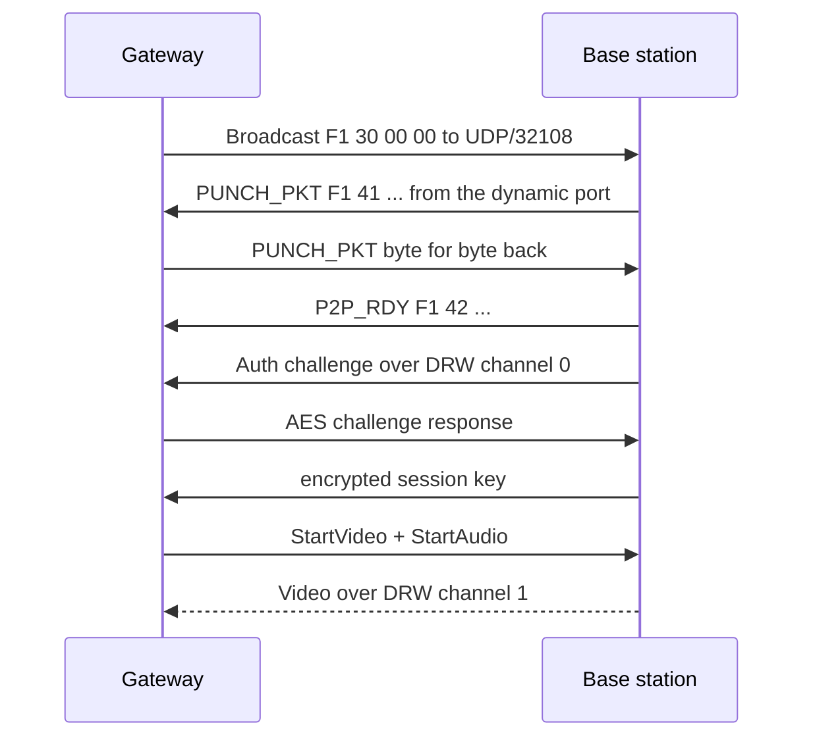

# Local PPCS protocol

## Status markers

- **Verified:** confirmed by live capture and hardware replies
- **Derived:** interoperable with real hardware, but the field meaning is not fully
  known
- **Open:** not implemented yet or not fully understood

## Device profile

| Property | Value |
|---|---|
| Base station model | `SMH-T1R` |
| DID prefix | `CMAG` |
| Base station firmware | `1.0.0.12` |
| Camera firmware per packet | `0.0.36.0` |
| Transport | proprietary CS2/PPCS/PPPP over UDP |
| Video | H.264 Annex-B, Main Profile |
| verified live resolution | 1920×1080, 25 fps |

IP addresses and dynamic ports depend on the installation and are not part of the
specification.

## WAI discovery: verified

- The controller binds UDP/7200 and sends a 32-byte broadcast to
  `255.255.255.255:7200`.
- The request starts with ASCII `WAI0`.
- The base station replies with 124 bytes and ASCII `WAI1`.

Relevant fields:

| Offset | Length | Content |
|---:|---:|---|
| 0 | 4 | `WAI1` |
| 16 | 17 | DID, NUL-terminated |
| 48 | 16 | Model, NUL-terminated |

WAI serves inventory only. The live session uses PPPP LAN discovery.

## PPPP base header: verified

```text
Offset  Size  Meaning
0       1     Magic 0xF1
1       1     Message type
2       2     Payload length, big endian
4       n     Payload
```

Message types in use:

| Type | Name | Direction |
|---:|---|---|
| `0x30` | LAN_SEARCH | controller to broadcast |
| `0x41` | PUNCH_PKT | hub to controller |
| `0x42` | P2P_RDY | hub to controller |
| `0xD0` | DRW | bidirectional data |
| `0xD1` | DRW_ACK | bidirectional acknowledgement |
| `0xE0` | ALIVE | bidirectional |
| `0xE1` | ALIVE_ACK | bidirectional |
| `0xF0` | CLOSE | bidirectional |

## Local session setup: verified



The source port of the PUNCH reply is the dynamic target port of the session. No
Oguard directory server is needed.

## DID in the PUNCH packet: verified

Payload after the 4-byte base header:

| Offset | Length | Content |
|---:|---:|---|
| 0 | 8 | Prefix, NUL-padded |
| 8 | 4 | Serial number, big endian |
| 12 | 6 | Check code, NUL-terminated |

Formatted DID: `<PREFIX>-<SERIAL:06d>-<CHECK>`.

## Authentication: verified

The base station starts authentication on DRW channel 0:

1. `authType=1`, 16-byte challenge
2. The gateway replies with `authType=2` and `AES-128-ECB(key, challenge)`
3. `key` is the UTF-8 security code, padded with zeros to 16 bytes or truncated to
   16 bytes
4. The base station sends `authType=3` and an encrypted 16-byte session key
5. The gateway decrypts the session key with AES-128-ECB
6. `authType=4` means rejected authentication

AES-ECB is a property of the legacy protocol, not a design decision of the
gateway.

## DRW framing: verified

```text
F1 D0 <length BE> D1 <channel> <sequence BE> <app data>
```

| Channel | Use |
|---:|---|
| 0 | Authentication and IO-Control |
| 1 | Video and media frames from the hub |

Every received fragment is acknowledged with `D1`. The 16-bit sequence number can
wrap. The gateway buffers out-of-order fragments per channel.

## App frame: verified

```text
Offset  Size  Meaning
0       3     Body length, little endian 24 bit
3       1     Stream type
4       16    AES-encrypted header
20      n     Payload
```

The decrypted media header contains:

- payload length at header offset 8, little endian `uint32`
- XOR obfuscation byte at header offset 4

The H.264 payload contains Annex-B start codes, SPS, PPS, IDR and P slices.

## IO-Control: verified

IO-Control frames use stream type `4`. The 16-byte header contains:

- control type at offset 0, little endian `uint16`
- payload length at offset 2, little endian `uint16`
- XOR byte at offset 4

Implemented commands:

| Control type | Function | Payload |
|---:|---|---|
| `1` | StartVideo | 8 bytes `Ex_IOCTRLAVStream` |
| `3` | StartAudio | 8 bytes `Ex_IOCTRLAVStream` |
| `5` / `6` | hub device info request/reply | 4-byte request; at least 56-byte reply |
| `40448` | camera battery | 16 bytes, channel in byte 0 |
| `40962` | coupled camera list | 16-byte request; channel count and 60-byte entries in the reply |
| `40963` | write camera parameters | complete 256-byte parameter block |
| `40964` | read camera parameters | 16-byte request; 256-byte reply |

`StartAudio` is sent for the verified session sequence but not evaluated. The
gateway discards audio data and offers no audio output (see
[ADR-0020](adrs/0020-no-audio-support.md)).

`Ex_IOCTRLAVStream`:

| Byte | Content |
|---:|---|
| 0 | camera index, zero-based |
| 4 | quality mode |
| 5 | audio notification/call flag |
| 6–7 | optional audio codec |

Quality modes:

| Value | Mode |
|---:|---|
| 0 | device setting |
| 1 | Full HD |
| 2 | HD |
| 3 | SD |
| 4 | automatic |

## Battery reply: verified

Reply to control type `40448`, at least 16 bytes:

| Byte | Content |
|---:|---|
| 0 | channel index |
| 1 | capacity in percent |
| 2 | `1` = charging, otherwise not charging |

The gateway reads immediately after stream start and then every 30 seconds.

## Hub camera list: verified

Reply to control type `40962`:

- bytes 0–3: count, little endian `uint32`
- then 60 bytes per camera:
  - byte 0: channel index
  - bytes 1–32: device name
  - bytes 33–48: model
  - bytes 49–52: firmware version, little endian
  - bytes 53–56: MCU version, little endian
  - byte 57: update capability

The real base station reports only actually coupled cameras. The gateway creates
no fixed phantom channels in the normal flow.

## Hub device info: verified

The reply to control type `6` contains, among other fields:

- bytes 0–15: model
- bytes 16–31: manufacturer
- bytes 32–35: firmware version in reversed byte order
- bytes 36–39: API version
- bytes 40–43: SD card total capacity in *decimal* MB (little endian `uint32`)
- bytes 44–47: SD card free space in *decimal* MB (little endian `uint32`)
- bytes 48–51: SD status (little endian `uint32`), for example `0` normal, `48` no
  card
- bytes 56–71: MCU version string if the reply is at least 72 bytes long

The reply contains no hub MAC. It may only be added from the local ARP table. The
known camera replies contain no camera MAC.

## Camera parameters and motion detection: verified

The parameter block of control type `40964` is 256 bytes long. Relevant fields:

| Byte | Content |
|---:|---|
| 0 | channel index |
| 1 | result |
| 2 | resolution index |
| 3 | environment mode |
| 4 | `pirMode`: `0` off, `1` active |
| 5 | PIR day sensitivity |

Writing is a read-modify-write: the gateway reads all 256 bytes, changes only byte
4, sends the complete block through `40963` and reads it again to verify. A partial
block must not be written, because that would overwrite unknown settings.

## Bitrate: gateway metric

The displayed bitrate is the number of H.264 payload bytes successfully written to
FFmpeg in the last full second. It excludes UDP, IP, PPPP, DRW, HLS and HTTP
overhead. The UI divides by 1024 and shows rounded `KB/s`.
