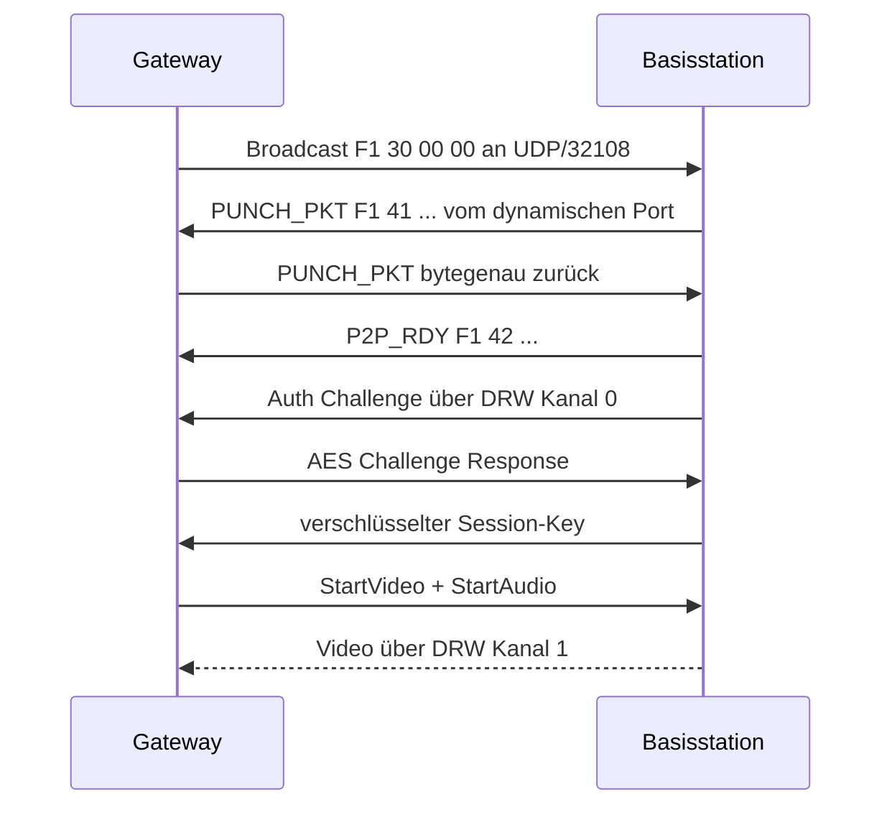

# Lokales PPCS-Protokoll

## Statuskennzeichnung

- **Verifiziert:** aus Live-Mitschnitt und Hardwareantworten bestätigt
- **Abgeleitet:** mit realer Hardware erfolgreich interoperabel, aber Feldbedeutung nicht vollständig bekannt
- **Offen:** noch nicht implementiert oder nicht abschließend verstanden

## Geräteprofil

| Eigenschaft | Wert |
|---|---|
| Basisstation-Modell | `SMH-T1R` |
| DID-Präfix | `CMAG` |
| Basisstationsfirmware | `1.0.0.12` |
| Kamerafirmware laut Paket | `0.0.36.0` |
| Transport | proprietäres CS2/PPCS/PPPP über UDP |
| Video | H.264 Annex-B, Main Profile |
| verifizierte Liveauflösung | 1920×1080, 25 fps |

IP-Adressen und dynamische Ports sind installationsabhängig und gehören nicht zur Spezifikation.

## WAI Discovery — verifiziert

- Controller bindet UDP/7200 und sendet einen 32-Byte-Broadcast an `255.255.255.255:7200`.
- Anfrage beginnt mit ASCII `WAI0`.
- Basisstation antwortet mit 124 Byte und ASCII `WAI1`.

Relevante Felder:

| Offset | Länge | Inhalt |
|---:|---:|---|
| 0 | 4 | `WAI1` |
| 16 | 17 | DID, NUL-terminiert |
| 48 | 16 | Modell, NUL-terminiert |

WAI dient nur der Inventarisierung. Der Live-Sitzungsaufbau verwendet die PPPP-LAN-Discovery.

## PPPP-Basisheader — verifiziert

```text
Offset  Größe  Bedeutung
0       1      Magic 0xF1
1       1      Nachrichtentyp
2       2      Payload-Länge, Big Endian
4       n      Payload
```

Verwendete Nachrichtentypen:

| Typ | Name | Richtung |
|---:|---|---|
| `0x30` | LAN_SEARCH | Controller → Broadcast |
| `0x41` | PUNCH_PKT | Hub → Controller |
| `0x42` | P2P_RDY | Hub → Controller |
| `0xD0` | DRW | bidirektionale Daten |
| `0xD1` | DRW_ACK | bidirektionale Bestätigung |
| `0xE0` | ALIVE | bidirektional |
| `0xE1` | ALIVE_ACK | bidirektional |
| `0xF0` | CLOSE | bidirektional |

## Lokaler Sitzungsaufbau — verifiziert



Der Quellport der PUNCH-Antwort ist der dynamische Zielport der Sitzung. Es wird kein Oguard-Verzeichnisserver benötigt.

## DID im PUNCH-Paket — verifiziert

Payload nach dem 4-Byte-Basisheader:

| Offset | Länge | Inhalt |
|---:|---:|---|
| 0 | 8 | Präfix, NUL-aufgefüllt |
| 8 | 4 | Seriennummer, Big Endian |
| 12 | 6 | Prüfcode, NUL-terminiert |

Formatierte DID: `<PREFIX>-<SERIAL:06d>-<CHECK>`.

## Authentifizierung — verifiziert

Die Basisstation initiiert die Authentifizierung auf DRW-Kanal 0:

1. `authType=1`, 16-Byte-Challenge
2. Gateway antwortet mit `authType=2` und `AES-128-ECB(key, challenge)`
3. `key` ist der UTF-8-Sicherheitscode, mit Nullen auf 16 Byte aufgefüllt beziehungsweise auf 16 Byte gekürzt
4. Basisstation sendet `authType=3` und einen verschlüsselten 16-Byte-Session-Key
5. Gateway entschlüsselt den Session-Key per AES-128-ECB
6. `authType=4` bedeutet abgelehnte Authentifizierung

AES-ECB ist eine Eigenschaft des Altprotokolls und keine Designentscheidung des Gateways.

## DRW-Framing — verifiziert

```text
F1 D0 <Länge BE> D1 <Kanal> <Sequenz BE> <App-Daten>
```

| Kanal | Verwendung |
|---:|---|
| 0 | Authentifizierung und IO-Control |
| 1 | Video-/Medienframes vom Hub |

Jedes empfangene Fragment wird mit `D1` bestätigt. Die 16-Bit-Sequenznummer kann umlaufen. Der Gateway puffert Out-of-order-Fragmente pro Kanal.

## App-Frame — verifiziert

```text
Offset  Größe  Bedeutung
0       3      Body-Länge, Little Endian 24 Bit
3       1      Streamtyp
4       16     AES-verschlüsselter Header
20      n      Nutzdaten
```

Der entschlüsselte Medienheader enthält:

- Nutzdatenlänge an Header-Offset 8, Little Endian `uint32`
- XOR-/Obfuskationsbyte an Header-Offset 4

Das H.264-Payload enthält Annex-B-Startcodes, SPS, PPS, IDR- und P-Slices.

## IO-Control — verifiziert

IO-Control-Frames verwenden Streamtyp `4`. Der 16-Byte-Header enthält:

- Control Type an Offset 0, Little Endian `uint16`
- Payload-Länge an Offset 2, Little Endian `uint16`
- XOR-Byte an Offset 4

Implementierte Befehle:

| Control Type | Funktion | Payload |
|---:|---|---|
| `1` | StartVideo | 8 Byte `Ex_IOCTRLAVStream` |
| `3` | StartAudio | 8 Byte `Ex_IOCTRLAVStream` |
| `5` / `6` | Hub-Geräteinfo Anfrage/Antwort | 4 Byte Anfrage; mindestens 56 Byte Antwort |
| `40448` | Kamera-Akku | 16 Byte, Kanal in Byte 0 |
| `40962` | gekoppelte Kameraliste | 16 Byte Anfrage; Kanalzahl und 60-Byte-Einträge als Antwort |
| `40963` | Kameraparameter schreiben | vollständiger 256-Byte-Parameterblock |
| `40964` | Kameraparameter lesen | 16 Byte Anfrage; 256-Byte-Antwort |

`StartAudio` wird für die verifizierte Sitzungssequenz gesendet, aber nicht ausgewertet. Der Gateway verwirft Audiodaten und bietet keine Audioausgabe (siehe [ADR-0020](adrs/0020-no-audio-support.md)).

`Ex_IOCTRLAVStream`:

| Byte | Inhalt |
|---:|---|
| 0 | Kameraindex, nullbasiert |
| 4 | Qualitätsmodus |
| 5 | Audio-Notification/Call-Flag |
| 6–7 | optionaler Audiocodec |

Qualitätsmodi:

| Wert | Modus |
|---:|---|
| 0 | Geräteeinstellung |
| 1 | Full HD |
| 2 | HD |
| 3 | SD |
| 4 | Automatisch |

## Batterieantwort — verifiziert

Antwort auf Control Type `40448`, mindestens 16 Byte:

| Byte | Inhalt |
|---:|---|
| 0 | Kanalindex |
| 1 | Kapazität in Prozent |
| 2 | `1` = lädt, sonst nicht ladend |

Der Gateway fragt unmittelbar nach Streamstart und danach alle 30 Sekunden ab.

## Hub-Kameraliste — verifiziert

Antwort auf Control Type `40962`:

- Byte 0–3: Anzahl, Little Endian `uint32`
- danach je Kamera 60 Byte:
  - Byte 0: Kanalindex
  - Byte 1–32: Gerätename
  - Byte 33–48: Modell
  - Byte 49–52: Firmwareversion, Little Endian
  - Byte 53–56: MCU-Version, Little Endian
  - Byte 57: Updatefähigkeit

Die reale Basisstation meldet nur tatsächlich gekoppelte Kameras. Der Gateway erzeugt im normalen Flow keine festen Phantomkanäle.

## Hub-Geräteinfo — verifiziert

Die Antwort auf Control Type `6` enthält unter anderem:

- Byte 0–15: Modell
- Byte 16–31: Hersteller
- Byte 32–35: Firmwareversion in umgekehrter Bytereihenfolge
- Byte 36–39: API-Version
- Byte 40–43: SD-Karten Gesamtkapazität in *dezimalen* MB (Little Endian `uint32`)
- Byte 44–47: SD-Karten freier Speicher in *dezimalen* MB (Little Endian `uint32`)
- Byte 48–51: SD-Status (Little Endian `uint32`), z.B. `0` normal, `48` keine Karte
- Byte 56–71: MCU-Versionsstring, sofern die Antwort mindestens 72 Byte lang ist

Eine Hub-MAC ist in dieser Antwort nicht enthalten. Sie darf ausschließlich aus der lokalen ARP-Tabelle ergänzt werden. Die bekannten Kameraantworten enthalten keine Kamera-MAC.

## Kameraparameter und Bewegungserkennung — verifiziert

Der Parameterblock von Control Type `40964` ist 256 Byte lang. Relevante Felder:

| Byte | Inhalt |
|---:|---|
| 0 | Kanalindex |
| 1 | Ergebnis |
| 2 | Auflösungsindex |
| 3 | Umgebungsmodus |
| 4 | `pirMode`: `0` aus, `1` aktiv |
| 5 | PIR-Tagessensitivität |

Schreiben erfolgt als Read-Modify-Write: Der Gateway liest alle 256 Byte, ändert ausschließlich Byte 4, sendet den vollständigen Block über `40963` und liest ihn zur Verifikation erneut. Ein Teilblock darf nicht geschrieben werden, da sonst unbekannte Einstellungen überschrieben würden.

## Bitrate — Gatewaymetrik

Die angezeigte Bitrate ist die Anzahl der in der letzten vollen Sekunde erfolgreich an FFmpeg geschriebenen H.264-Nutzdatenbytes. Nicht enthalten sind UDP-, IP-, PPPP-, DRW-, HLS- oder HTTP-Overheads. Die UI teilt durch 1024 und zeigt gerundete `KB/s`.
